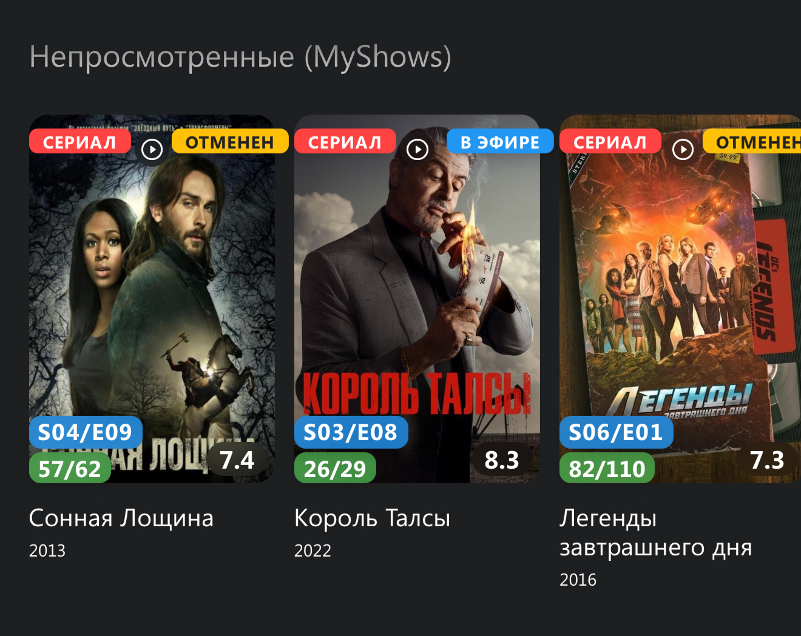

[Русский](https://igorek1986.github.io/lampa-plugins/docs/myshows) · **English**

📺 MyShows plugin for [Lampac](https://github.com/immisterio/Lampac) and [Lampa](http://lampa.mx/)  
Automatic sync of watched series and movies with MyShows.me  



🔹 Key features

- ✅ Login/password authentication (no manual token entry required)  
- ✅ Multi-profile support — individual settings for each Lampa profile  
- ✅ Automatic token refresh on expiration  
- ✅ Series watch progress display  
- ✅ Next unwatched episode display  
- ✅ "Unwatched series (MyShows)" shown on the CUB/TMDB Home screen  
- ✅ Flexible conditions for adding a series to "Watching":  
- Immediately when the first episode starts.  
- After watching 5% to 50% of the first episode  

- ✅ Accurate watch sync with a configurable mark threshold (50%-100%)  

- ✅ Smart operating mode:  
- Marks watched episodes and movies  

🆕 What's new:

- **Customizable card badges** — three independent toggles:  
- "Episodes progress" — watched / total episodes (e.g. 5/12)  
- "Episodes left" — number of unwatched episodes  
- "Next episode" — number of the next episode (e.g. S01E05)  
- **Badge placement** — two layout options:  
- Variant 1 — classic.  
- Variant 2 — next episode bottom-left, progress bottom-right, episodes left top-right, with rounded corners like the card.  
- **"Next episode" badge** — now also visible in the "Torrents" / "Online" windows, updates after the player is closed.  
- **Series sorting** — 8 options: alphabetical, by relevance, by progress, by unwatched count, by last episode date (↑/↓), by first unwatched date (↑/↓).
- **MyShows Calendar** — episode release dates from MyShows right in the "Calendar" section.  
- **"Unwatched series" on Home** — a separate toggle for showing the section on the CUB/TMDB home screen.  
- **NP-server storage mode** — the "Use NP server" setting: unwatched series data is stored on the server for fast loading across all devices.  
- **Cross-device settings sync (NMSync)** — badges, sorting and other settings apply across all your devices automatically.  
- **Manual sync with Lampac** — a "Sync" button for a one-time full reconciliation of watched content.  

### MyShows ratings

On a movie card, the eye toggles its watched mark: pressing it again removes
the mark. The separate **Оценить в MyShows** star opens rating. **Не смотрел**
also removes the watched mark. A failed request keeps the original state.
For shows, the eye retains the existing Watching action.

After a movie or episode is successfully marked watched, the plugin reads the
personal MyShows rating and offers 1 to 5 only if it is still unrated. A failed
or unrecognized rating lookup skips the automatic prompt. Episode dialogs
explicitly say **Оцените серию** (Rate this episode), include the season/episode
number, and explain that the rating is for the episode, not the whole show. The prompt waits until playback ends, including a successful
MyShows reply arriving after player closure. Multiple episodes keep separate
queued prompts with the show title and episode number. Repeated progress updates
do not offer the same rating again.

**Пропустить** (Skip) and Back dismiss the prompt without writing a rating.
A rating error keeps the successful watched mark and lets you retry explicitly
or skip. Switching profiles, logging out or replacing the token cancels old
prompts and their callbacks.

The movie card's **Оценить в MyShows** (Rate in MyShows) button allows a rating
to be added or changed, including for an already watched movie. MyShows also
treats a rated movie as watched; the selector explains this for an unwatched
movie. The plugin sends only the rating request, without an additional status
mutation. Rating an entire show from its card is outside this feature.

For an external player, the prompt waits for a confirmed hidden-to-visible
return to Lampa or a player destroy event. Wrappers that provide neither event
may not display the deferred prompt; the movie card button remains available.

### Watched in MyShows

The **Просмотренное в MyShows** setting is local to this device/profile and
offers **Показывать обычно** (Show normally), **Приглушать и отмечать ✓**
(Dim and mark), and **Скрывать** (Hide). Mark keeps the original cards, count,
order and source pages, adding ✓ and dimming only confirmed watched posters.
Remote focus restores normal poster brightness without dimming text or the
focus ring. Hide fills a shortened batch from following source pages until it
reaches the original batch size or the source ends. All visible cards from
consumed pages are returned: 15 plus another 15 yields 30, without discarding
the extra cards. A refill error keeps collected cards and asks you to retry.

Ordinary CUB/TMDB home rows, catalogues, collections, Top 100 and native
recommendations/More are covered. Search and its More pages, favorites, history,
Continue watching, MyShows, calendar and custom rows receive no new mark.
The default is Show normally. An enabled legacy Hide watched switch migrates
to Hide; an explicit new mode always wins and persists across restarts/profile
changes. The setting is excluded from NMSync.

A show is hidden only when at least one episode was watched and every released
episode ID is confirmed in its viewing history. Future episodes are ignored;
unknown dates, incomplete history and API errors leave the show visible. A new
released episode returns its card at the next catalogue opening or native
refresh. The switch and successful watch/status changes refresh ordinary Lampa
activities. Filtering never changes MyShows marks.

MyShows IDs are never treated as TMDB IDs. Without a verified mapping, matching
requires a unique media type, literal title and exact year. Unknown or ambiguous
cards stay visible. Conflicting explicit original titles keep the card visible
even when localized titles and years match. Following pages are read until
the original batch size is reached or real source
exhaustion; Top 100 is not extended beyond its original hundred. Disabling the
switch restores the original cards and order.

The in-memory session index is invalidated by profile/token changes, logout and
successful mark changes. Every catalogue opening/refresh confirms it afresh.
Only matching shows in the current results request details, with deduplication,
caching and bounded concurrency. There is no periodic poll. Failed checks show
a notification and keep cards visible. Arbitrary third-party sources are not
intercepted.

### Relevance sorting

Choose **По актуальности** (By relevance) in series sorting. Shows rank by the
newer of their last episode viewing date and latest released unwatched episode
date, descending. Ties use alphabetical order. Progress remains the default.
The list appears immediately using known dates. If loaded history changes the
order, the current page refreshes through Lampa: a recent show enters the first
20 cards, and More uses the complete updated order.

This mode requests MyShows viewing history for sorting. Dates are stored locally per
profile and retained after completing a show; NP cards without dates use known
local dates. Successful episode marks update the viewing date; undoing a mark
reloads history. Request failures retain known dates and cards, while successful
empty history clears the viewing date. Missing, ambiguous, invalid and future
dates do not raise priority. The Lampa list and Android TV channel share the
ordering; private viewing dates are not sent to Android.

### Android TV home channel (optional)

In MyShows settings, enable **MyShows на главном экране Android TV** to publish
unwatched shows as a separate **MyShows** channel. This requires an Android TV
Lampa build exposing `AndroidJS.publishPluginChannel` and
`AndroidJS.clearPluginChannel`, plus a launcher that displays application channels
(for example, Projectivy). Older APKs and browsers keep working and explain the
unsupported capability in the setting.

The switch defaults to off and is saved per profile on this device; it is not
synced to other devices. The channel follows the selected MyShows sort order.
Cards open the existing Lampa show page. Their description includes the next
episode and unwatched count when available; stream availability and automatic
episode playback are not implied.

The existing cache appears first, then the successful fresh list replaces it.
Publication updates while Lampa runs, after list refreshes and episode/status
changes. When Lampa is closed, cards remain but new episodes wait for the next
Lampa startup/refresh. A request error preserves the current profile's last
successful list; a successful empty list clears it. Switching profiles, logging
out, or disabling the switch immediately requests clearing the previous cards.
If the native bridge rejects clearing, the plugin reports that failure instead
of claiming the old cards were removed. Launcher channel visibility and row
order are configured in the launcher. Favorites and Watch Next are separate.

For reproducible release generation and regression tests, see
[MyShows development](myshows-development.md).

⚙️ Plugin settings  
- 🔐 Authentication via a proxy server (login/password are not stored in plain text) [myshows_proxy](https://github.com/Igorek1986/myshows_proxy)  
- 🎚 Add-to-"Watching" threshold and watch-mark threshold  
- ⏳ Cache lifetime (7–90 days)  
- 🎛 Badge display and placement, sorting, management buttons on cards  


🔧 Technical highlights  
- Works with the built-in player and external players (that report a timecode)  
- 📊 Integration with the Lampac progress storage  
- 🔍 Series detection by IMDB ID  
- 💾 Local data caching to reduce API requests. Cache lifetime (7-90 days)  
- 🔄 Sync of watched movies and series with Lampac. Requires the [TimecodeUser](https://github.com/Igorek1986/lampa-plugins/tree/main/module/TimecodeUser) module  

🧩 Public JS API for other plugins  
The plugin exports `window.MyShows` — other Lampa plugins can use it without duplicating MyShows ID resolution and authentication:

- `isLoggedIn()` — whether the current profile is logged in to MyShows.
- `setStatus(cardData, status, isMovie, callback)` — set a card's status on MyShows without your own ID resolution (by IMDB/Kinopoisk ID or title+year). `cardData` is a regular Lampa/TMDB card object (`id`, `imdb_id`/`kinopoisk_id`, `title`/`name`, release date). Series statuses: `watching`/`later`/`cancelled`/`remove`; movie statuses: `finished`/`later`/`remove`. `callback(success)` fires after the MyShows request completes.
- `openPage()` — open the "MyShows" section (unwatched series) as a Lampa activity.
- `getUnwatchedShowsWithDetails(callback)` — get the list of unwatched series with details (progress, next episode, etc.).

Check availability and login before calling:
```js
if (window.MyShows && window.MyShows.isLoggedIn && window.MyShows.isLoggedIn()) {
    window.MyShows.setStatus(cardData, 'watching', false, function (success) { /* ... */ });
}
```
See np_unwatched.js (full-card status buttons) for a live usage example.

📌 How it works  
- On watch start:  

- Detects the series by IMDB ID (Kinopoisk ID, original title and year)  
- Checks the conditions for adding to "Watching"  
- Builds a local episode mapping  
- Detects the movie by original title and release year.  

- On watch completion:  
- Tracks progress along the timeline  
- Once the threshold is reached, marks it as watched  

💡 Usage tips  
- ✔️ For new users — just enter your MyShows login/password  
- ✔️ Set comfortable mark thresholds for your viewing style  


🔄 What's new in this version  
- Completely reworked authentication system  

- Lampa multi-profile support  
- Improved episode detection algorithm  
- Optimized number of API requests  
- More stable operation  
