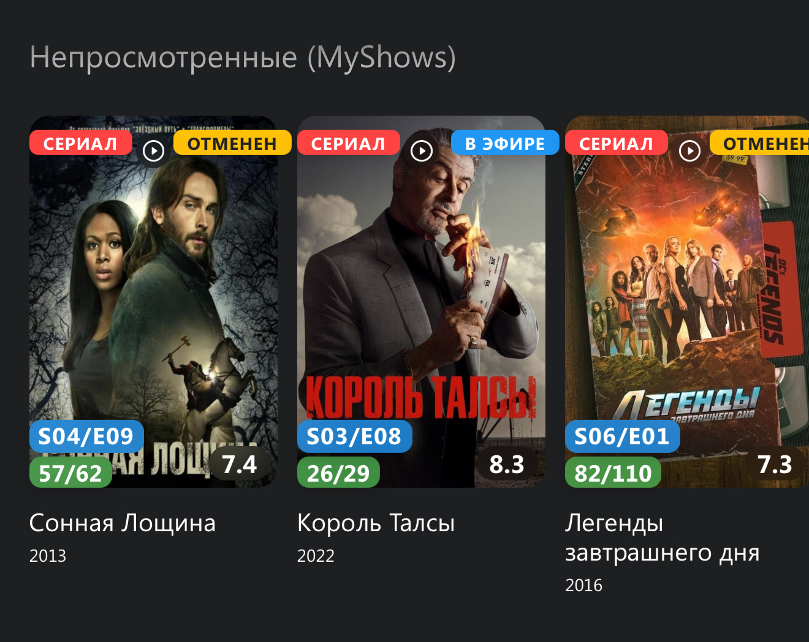

**Русский** · [English](https://igorek1986.github.io/lampa-plugins/docs/en/myshows)

📺 Плагин MyShows для [Lampac](https://github.com/immisterio/Lampac) и [Lampa](http://lampa.mx/)  
Автоматическая синхронизация просмотра сериалов и фильмов с MyShows.me  



🔹 Основные возможности

- ✅ Авторизация через логин/пароль (не требует ручного ввода токена)  
- ✅ Поддержка мультипрофильности - индивидуальные настройки для каждого профиля Lampa  
- ✅ Автоматическое обновление токена при истечении срока действия  
- ✅ Отображение прогресса просмотра сериала  
- ✅ Отображение Следующей непросмотренной серии  
- ✅ "Непросмотренные сериалы (MyShows)" отображаеются на Главной CUB/TMDB
- ✅ Гибкие условия добавления сериалов в "Смотрю":  
- Сразу при запуске первой серии.  
- После просмотра от 5% до 50% первой серии  

- ✅ Точная синхронизация просмотра с настройкой порога отметки (50%-100%)

- ✅ Интеллектуальных режим работы:
- Отмечает просмотренные серии и фильмы

🆕 Новое в плагине:

- **Настраиваемые значки на карточках** — три независимых переключателя:  
- «Прогресс эпизодов» — просмотрено / всего серий (например, 5/12)  
- «Осталось серий» — количество непросмотренных серий  
- «Следующий эпизод» — номер следующей серии (например, S01E05)  
- **Расположение значков** — два варианта оформления:  
- Вариант 1 — классический.  
- Вариант 2 — следующий эпизод слева внизу, прогресс справа внизу, остаток серий справа вверху, со скруглениями как у карточки.  
- **Метка «Следующая серия»** — теперь видна и в окнах «Торренты» / «Онлайн», обновляется после закрытия плеера.  
- **Сортировка сериалов** — 8 вариантов: по алфавиту, по актуальности, по прогрессу, по числу непросмотренных, по дате последнего эпизода (↑/↓), по дате первого непросмотренного (↑/↓).
- **Календарь MyShows** — даты выхода эпизодов из MyShows прямо в разделе «Календарь».  
- **«Непросмотренные сериалы» на Главной** — отдельный переключатель показа секции на главной CUB/TMDB.  
- **Режим хранения на NP-сервере** — настройка «Использовать NP сервер»: данные о непросмотренных сериалах хранятся на сервере для быстрой загрузки на всех устройствах.  
- **Синхронизация настроек между устройствами (NMSync)** — значки, сортировка и прочие настройки применяются на всех ваших устройствах автоматически.  
- **Ручная синхронизация с Lampac** — кнопка «Синхронизировать» для разовой полной сверки просмотренного.  

### Оценки MyShows

В карточке фильма глаз переключает просмотр: повторное нажатие снимает отметку.
Звезда **Оценить в MyShows** отвечает отдельно за оценку. Кнопка **Не смотрел**
также позволяет снять просмотр. Если MyShows отклонил изменение, прежний статус
сохраняется. Для сериалов глаз по-прежнему устанавливает статус «Смотрю».

После успешной отметки фильма или серии просмотренной плагин проверяет личную
оценку в MyShows и предлагает от 1 до 5 только для ещё не оценённого контента.
Если проверить оценку не удалось, автоматическое предложение пропускается.
Окно серии явно озаглавлено **Оцените серию**, содержит сезон и номер серии,
а пояснение уточняет: это оценка отдельной серии, не всего сериала. Во время воспроизведения окно не появляется: предложение ждёт выхода
из плеера, в том числе если ответ MyShows пришёл позже. После нескольких серий
предложения идут по очереди, с названием сериала и номером серии. Повторные
обновления прогресса не предлагают ту же оценку снова.

**Пропустить** и Back закрывают предложение без записи оценки. Ошибка сохранения
не снимает отметку просмотра: можно выбрать оценку повторно или пропустить.
Смена профиля, выход из MyShows и замена токена отменяют старые предложения.

В карточке фильма кнопка **Оценить в MyShows** позволяет поставить или изменить
оценку, в том числе для уже просмотренного фильма. MyShows также считает
оценённый фильм просмотренным: для ещё не просмотренного фильма окно явно
сообщает об этом. Плагин отправляет только запрос оценки; дополнительного
запроса изменения статуса при оценке нет. Оценка всего сериала из карточки
в эту функцию не входит.

Для внешнего плеера предложение ждёт подтверждённого возвращения страницы
Lampa из скрытого состояния либо события закрытия плеера. Оболочки, которые
не передают такие события, могут не показать отложенное предложение;
кнопка в карточке фильма остаётся доступной.

### Просмотренное в MyShows

Настройка **Просмотренное в MyShows** сохраняется только на этом устройстве,
отдельно для каждого профиля. Доступны три режима:

- **Показывать обычно** — исходные карточки без новых отметок.
- **Приглушать и отмечать ✓** — достоверно просмотренные карточки остаются на
  своих местах с ✓ и приглушённым постером. При фокусе пульта яркость постера
  возвращается; название, рамка фокуса и управление сохраняются.
- **Скрывать** — фильтрация полностью просмотренных карточек с добором выдачи.

Если из исходных 20 карточек осталось 15, режим скрытия загружает следующую
страницу и показывает все её непросмотренные карточки вместе с первыми 15.
Поэтому выдача может содержать, например, 30 карточек: лишние не теряются.
Добор заканчивается, когда набран исходный размер порции или источник исчерпан.
При ошибке сохраняется уже собранное и появляется предложение повторить загрузку.

Порядок, количество и страницы в режиме отметки не меняются. Режим действует
в обычных каталогах CUB/TMDB, на главной, в стандартных подборках, «Топ-100» и
встроенных рекомендациях с их «Ещё». Поиск, избранное, история, «Продолжить»,
MyShows, календарь и сторонние строки не получают новых отметок и сохраняются.
Без прежнего выбора используется «Показывать обычно». Старое включённое
«Скрывать просмотренное» переносится в «Скрывать»; явный новый выбор всегда
имеет приоритет. Синхронизация NMSync не переносит эту настройку.

Сериал скрывается только при наличии хотя бы одной просмотренной серии и
подтверждённом просмотре всех вышедших эпизодов. Будущие серии не мешают;
неизвестная дата, ошибка API или неполная история оставляют сериал видимым.
После выхода новой серии карточка возвращается или теряет ✓ при следующем открытии или
штатном обновлении каталога. Переключение и успешные изменения отметок обновляют
обычные активности Lampa; фильтр сам ничего не отмечает в MyShows.

Идентификаторы MyShows и TMDB не смешиваются. Без подтверждённой привязки
используется только однозначное совпадение типа, названия и точного года.
Если обе стороны содержат разные оригинальные названия, карточка остаётся
видимой даже при совпадении локализованного названия и года. Неизвестные и
неоднозначные карточки видимы. Следующие страницы догружаются
до исходного размера порции или конца исходного каталога; «Топ-100» не дополняется за
пределы исходной сотни. Выключение возвращает исходные карточки и их порядок.

Индекс живёт в памяти текущего сеанса, сбрасывается при смене профиля/токена,
выходе и успешных изменениях отметок; каждое новое открытие или обновление
каталога подтверждает данные заново. Подробности запрашиваются только для
подходящих сериалов из текущей выдачи, с кешем и ограничением параллельности.
Постоянного опроса нет. Сбой проверки сообщается уведомлением и сохраняет
карточки видимыми. Произвольные источники других плагинов не перехватываются.

### Сортировка «По актуальности»

Выберите «По актуальности» в настройке сортировки сериалов. Выше поднимаются
сериалы с более свежей датой: последнего просмотра серии или выхода последней
уже вышедшей непросмотренной серии. При равных датах действует алфавитный порядок.
По умолчанию сохраняется сортировка по прогрессу.
Список появляется сразу по известным датам. Если загруженная история меняет
порядок, текущая страница обновляется штатным механизмом Lampa: свежий сериал
попадает в первые 20 карточек, а «Ещё» использует полный новый порядок.

Этот режим запрашивает историю просмотра MyShows для сортировки. Даты сохраняются локально
для каждого профиля, в том числе после полного просмотра сериала; NP-карточки без
дат используют известные локальные даты. Успешная отметка обновляет дату просмотра,
снятие отметки перечитывает историю. Ошибка запроса сохраняет известную дату и
карточки; успешная пустая история очищает дату просмотра. Отсутствующие,
неоднозначные, повреждённые и будущие даты не повышают приоритет. Список Lampa и
канал Android TV используют один порядок; личные даты в Android не передаются.

### Канал на главном экране Android TV (по желанию)

В настройках MyShows включите **MyShows на главном экране Android TV**, чтобы
показать непросмотренные сериалы отдельным каналом **MyShows**. Нужна сборка
Lampa для Android TV с методами `AndroidJS.publishPluginChannel` и
`AndroidJS.clearPluginChannel`, а также лаунчер с поддержкой каналов приложений,
например Projectivy. Старые APK и браузеры продолжают работать; настройка
объясняет, почему публикация недоступна.

Переключатель по умолчанию выключен. Он сохраняется для каждого профиля на
этом устройстве и не синхронизируется на другие устройства. Канал следует
выбранной сортировке MyShows. Карточки открывают существующую страницу сериала
Lampa; описание содержит номер следующей серии и остаток серий, если эти данные
есть. Наличие потока у видеопровайдера и автоматический запуск серии не обещаются.

Сначала появляется существующий кеш, затем его заменяет успешный свежий список.
Обновление идёт, пока работает Lampa, после обновления списка и изменения отметок
серий или статуса сериала. При закрытой Lampa карточки сохраняются, но новые серии
появятся только после следующего запуска/обновления Lampa. Ошибка запроса сохраняет
последний успешный список текущего профиля; успешный пустой список очищает его.
Смена профиля, выход из MyShows или выключение переключателя немедленно запрашивают
очистку прежних карточек. Если нативный интерфейс отклоняет очистку, плагин сообщает
об этом и не утверждает, что карточки удалены. Видимость и порядок строк
настраиваются в лаунчере. Избранное и Watch Next остаются отдельными каналами.

Воспроизводимая генерация вариантов и регрессионные тесты описаны в
[MyShows development](en/myshows-development.md).

⚙️ Настройки плагина  
- 🔐 Аторизация через прокси-сервер (логин/пароль не хранятся в открытом виде) [myshows_proxy](https://github.com/Igorek1986/myshows_proxy)  
- 🎚 Порог добавления в «Смотрю» и порог отметки просмотра  
- ⏳ Время жизни кеша (7–90 дней)  
- 🎛 Показ и расположение значков, сортировка, кнопки управления в карточках  


🔧 Технические особенности 
- Работает со встроенным плеером и внешним плеером (отдающим timecode)
- 📊 Интеграция с системой хранения прогресса Lampac  
- 🔍 Определение сериалов по IMDB ID 
- 💾 Локальное кэширование данных для уменьшения запросов к API.  Время жизни кеша (7-90 дней)  
- 🔄 Синхронизация просмотренных фильмов и сериалов с Lampac. Требудется модуль [TimecodeUser](https://github.com/Igorek1986/lampa-plugins/tree/main/module/TimecodeUser)

🧩 Публичный JS API для других плагинов  
Плагин экспортирует `window.MyShows` — им можно пользоваться из других Lampa-плагинов, не дублируя резолвинг ID и авторизацию MyShows:

- `isLoggedIn()` — залогинен ли текущий профиль в MyShows.
- `setStatus(cardData, status, isMovie, callback)` — выставить статус карточки в MyShows без собственного резолвинга ID (по IMDB/Kinopoisk ID или названию+году). `cardData` — обычная карточка Lampa/TMDB (`id`, `imdb_id`/`kinopoisk_id`, `title`/`name`, дата выхода). Статусы для сериалов: `watching`/`later`/`cancelled`/`remove`; для фильмов: `finished`/`later`/`remove`. `callback(success)` вызывается после запроса к MyShows.
- `openPage()` — открыть раздел «MyShows» (непросмотренные сериалы) как активность Lampa.
- `getUnwatchedShowsWithDetails(callback)` — получить список непросмотренных сериалов с деталями (прогресс, следующая серия и т.д.).

Перед вызовом проверяйте доступность плагина и авторизацию:
```js
if (window.MyShows && window.MyShows.isLoggedIn && window.MyShows.isLoggedIn()) {
    window.MyShows.setStatus(cardData, 'watching', false, function (success) { /* ... */ });
}
```
Живой пример использования — кнопки статуса на полной карточке в np_unwatched.js.

📌 Как это работает  
- При старте просмотра:  

- Определяет сериал по IMDB ID (Kinopoisk ID, Original Titile and year)  
- Проверяет условия добавления в "Смотрю"  
- Создает локальный mapping серий  
- Определяет фильм по Оригинальному названию и году выпуска. 

- По завершению просмотра:  
- Отслеживает прогресс по таймлайну  
- При достижении порога - отмечает просмотр  

💡 Советы по использованию  
- ✔️ Для новых пользователей - просто введите логин/пароль от MyShows  
- ✔️ Настройте комфортные пороги отметки под ваш стиль просмотра  


🔄 Что нового в этой версии  
- Полностью переработанная система авторизации  

- Поддержка мультипрофильности Lampa  
- Улучшенный алгоритм определения серий  
- Оптимизированное количество запросов к API  
- Более стабильная работа
